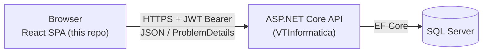

# VT Informatica – front end

[🇮🇹 Italiano](README.md) · 🇬🇧 English

Front end of an e-commerce site selling PC tech products: catalogue, search, cart, checkout, orders, reviews, account area and an `Admin` back office. It talks to the API in [VTInformatica](https://github.com/Anacronistico00/VTInformatica) (ASP.NET Core + SQL Server).

It started as a course final project (tag `v1-epicode`), then went through an audit and was realigned with the API contract (`v2-m4`). The [Before / after](#before--after) and [How I worked with AI](#how-i-worked-with-ai) sections tell the story.

## Stack

- React 19, Vite 6 (SWC plugin), JavaScript, React Router 7
- Redux Toolkit + Redux Persist (localStorage, 1 h expiry), React Bootstrap / Bootstrap 5, React Toastify, Framer Motion
- Tests: Vitest + Testing Library + MSW (network simulated on the real API contract); E2E: Playwright
- CI: GitHub Actions (lint, test, build)

## Architecture



- `src/Components/`: pages and components (`Admin/`, `Auth/`, `Home/`, `NavBar/`, `Products/`). Routes live in `App.jsx`; admin routes go through `Auth/roleRoute.jsx`.
- `src/Redux/`: `Actions` (thunks), `Reducers`, `Store`. HTTP calls live **only** in the actions.
- `src/Utils/apiClient.js`: the single HTTP client (base URL from `VITE_API_URL`, `Authorization` header, 204, network errors, `ProblemDetails` → `ApiError { status, code, detail, errors }`). A 401 on a request carrying a token logs the user out.
- API errors are told apart by the `code` field, never by message text; user-facing messages live in one file.
- Identity comes from the token on the BE side (`/me` routes): the FE role check (`RoleRoute`) is UX only, security is in the API.
- Tests sit next to the file they verify (`*.test.js[x]`); setup, MSW server and test JWTs are in `src/test/`.

## Running locally

Prerequisites: Node 22 and the API running (see the [BE README](https://github.com/Anacronistico00/VTInformatica/blob/develop/README.en.md): database, JWT key via User Secrets, first admin).

1. **Clone both repos** side by side:

   ```bash
   git clone https://github.com/Anacronistico00/vtinformatica_fe.git
   git clone https://github.com/Anacronistico00/VTInformatica.git
   ```

2. **Start the BE** (from the `VTInformatica` folder): database from `DatabaseScript.sql` + `dotnet ef database update`, key with `dotnet user-secrets set "Jwt:SecurityKey" "<at least 32 characters>" --project VTInformatica`, then:

   ```bash
   dotnet run --project VTInformatica --launch-profile https   # https://localhost:7286
   ```

3. **Configure the FE.** The API URL comes from `VITE_API_URL`; it is never in the code. `.env.local` is not committed (`.env.example` documents the variables):

   ```bash
   cd vtinformatica_fe
   npm ci
   cp .env.example .env.local   # VITE_API_URL=https://localhost:7286
   ```

4. **Start the FE:**

   ```bash
   npm run dev                  # http://localhost:5173
   ```

   `http://localhost:5173` is the origin the BE's CORS allows by default.

5. **First admin, via the DB.** Every registration creates a `Customer`; to get the back office, register the user from the FE and grant the role (the BE has no endpoint to create admins yet):

   ```sql
   INSERT INTO AspNetUserRoles (UserId, RoleId)
   SELECT u.Id, r.Id
   FROM AspNetUsers u, AspNetRoles r
   WHERE u.Email = 'your@email.com' AND r.Name = 'Admin';
   ```

   Then log in again: the role is in the token.

## Tests

```bash
npm test          # Vitest + Testing Library + MSW
npm run lint
npm run build
```

These are the same checks as CI (no backend and no secrets: the network is simulated with MSW). Every logic change has a test; for known bugs, a red test first, then the fix.

## E2E (Playwright)

Full flows in the browser against the **local BE and SQL Server DB** (login → cart → checkout → order, account, back office, reviews). They do not run in CI.

```bash
npx playwright install chromium   # once
npm run e2e
```

The E2E FE port is **fixed: 5174**, with `--strictPort` (if it is taken the run fails instead of moving elsewhere); 5173 stays free for development. The BE must therefore allow that origin in CORS. If you let Playwright start the BE it does so itself; if the BE is already running (it is reused), **restart it with**:

```bash
Cors__AllowedOrigins__1=http://localhost:5174 dotnet run --project VTInformatica --launch-profile https
```

(PowerShell: `$env:Cors__AllowedOrigins__1='http://localhost:5174'` before `dotnet run`.) There is no need to touch the BE's `appsettings.json`. Without this origin the login in the E2E run fails with "Server non raggiungibile".

Variables (Windows authentication to SQL Server, no password in the repo):

| Variable           | Default                  | Use                                                          |
| ------------------ | ------------------------ | ------------------------------------------------------------ |
| `E2E_API_URL`      | `https://localhost:7286` | BE URL                                                       |
| `E2E_FE_PORT`      | `5174`                   | E2E FE port                                                  |
| `E2E_SQLCMD`       | `sqlcmd`                 | sqlcmd executable                                            |
| `E2E_SQL_SERVER`   | `(local)`                | Server (e.g. `np:\\.\pipe\MSSQL$SQLEXPRESS\sql\query`)       |
| `E2E_SQL_DATABASE` | `VTInformatica`          | Database                                                     |

From Git Bash the backslashes of the named pipe must be doubled and `MSYS_NO_PATHCONV=1` helps, e.g. `MSYS_NO_PATHCONV=1 E2E_SQL_SERVER='np:\\\\.\\pipe\\MSSQL$SQLEXPRESS\\sql\\query' npm run e2e`.

The tests create `e2e.*@example.test` users and `E2E …` products and delete them at the end of the run (only those, in one transaction). **Back up the DB before the first run.** Details in [`e2e/README.md`](e2e/README.md) (Italian).

## Before / after

Numbers are **recomputed from the tags** (clean worktree per tag: `npm ci`, `npm run lint`, `npm test`, `npm run build`, `npm audit`; on the BE side `dotnet build --no-incremental`, `dotnet test`; `git diff --shortstat v1-epicode <tag>`), not copied from reports. The FE only has the tags `v1-epicode` and `v2-m4` (all its changes belong to M4), so the middle columns have no FE measurement.

| | `v1-epicode` | `v2-m1` | `v2-m2` | `v2-m3` | `v2-m4-be` / FE `v2-m4` |
|---|---:|---:|---:|---:|---:|
| BE tests (xUnit) | 0 | 42 | 54 | 240 | **243** |
| FE tests (Vitest) | 0 | – | – | – | **93** (+ 8 E2E flows) |
| `dotnet build` warnings (Release, clean) | 114 | 112 | 110 | **0** | **0** |
| FE lint (`npm run lint`) | 5 problems (2 errors, 3 warnings) | – | – | – | **0** |
| FE build warnings | 1 (chunk > 500 kB) | – | – | – | 1 (unchanged) |
| FE `npm audit` | 16 (12 high, 2 moderate, 2 low) | – | – | – | **0** |
| CI | none | BE build + test | same | same | BE: build + test; FE: lint + test + build |
| BE `.cs` files (tracked) | 96 | 108 | 117 | 174 | 176 |
| FE `.js/.jsx` files in `src/` | 52 | – | – | – | 86 |
| Diff vs `v1-epicode` (BE) | – | 27 files, +1620 −12 | 41 files, +3520 −93 | 172 files, +14558 −1459 | 175 files, +14720 −1457 |
| Diff vs `v1-epicode` (FE) | – | – | – | – | 87 files, +8418 −1505 |

Notes:

- Diff lines include tests (most of the growth). Large components: `ManageProductsComponent` 361 → 160 lines, `ProductInfo` 313 → 339 (not split yet).
- The 8 E2E flows were not re-run for this table: they only run locally. CI does not run them (it would need SQL Server on the runner).

FE audit items closed in `v2-m4` (details in [`docs/AUDIT-prima.md`](docs/AUDIT-prima.md), in Italian): hardcoded backend URL → `VITE_API_URL`; repeated `fetch` boilerplate → single `apiClient` (33 calls migrated); duplicated token in localStorage → one in the `auth` slice, expired token not restored; 401 handling → logout; email in the URL → `/me` routes; zero tests and no CI → Vitest/MSW/Playwright and GitHub Actions; lint (2 errors → 0); `npm audit` (16 → 0); product back office with server-side pagination (`X-Total-Count`) and `expectedQuantity` (409 `stock_conflict`).
The BE items closed per tag (security, orders, errors, queries) are in the [BE README](https://github.com/Anacronistico00/VTInformatica/blob/develop/README.en.md#before--after).

## How I worked with AI

I used Claude Code for most of the code. The process changed over time.

- **Initial audit as the source of truth.** Before touching code I had an audit produced and reviewed ([`docs/AUDIT-prima.md`](docs/AUDIT-prima.md), in Italian): problems ranked by severity plus starting metrics. The baseline is never rewritten. Each slice appends a status section: closed, moved, out of scope.
- **Milestones and slices.** The audit became milestones (M0–M4), split into small slices (M4a–M4g for the FE): one task, one branch, small commits, PR into `develop` with green CI using "Rebase and merge", `main` only at the end of a milestone with a merge commit and an annotated tag.
- **M1–M2: everything approved by hand, plans reviewed by a second model.** I approved every agent action. I reviewed every plan (`docs/PIANO-*.md`, for the FE [`docs/PIANO-M4.md`](docs/PIANO-M4.md)) in a separate conversation with another model acting as reviewer, and only then gave the agent the go-ahead. The review produced concrete corrections (BE side):
  - **Role seed drift.** Roles were seeded with `Guid.NewGuid()`: a new migration would have deleted and re-inserted the roles, emptying `AspNetUserRoles`. Found before generating the migration. Fixed GUIDs, identical to the existing DBs, plus a test comparing model and snapshot.
  - **Wrong concurrency test.** It measured stock after the rollback, so it did not prove the decrement was atomic. Rewritten to check the outcome of two parallel requests.
  - **Slices too large.** M3 was a single block. I split it (a1, a2, b, c1, c2, d) so each piece could be reviewed and reverted on its own.
  - **Parallel `/me` routes.** To move identity into the token I did not break the FE: `/Cart/me` and `/Order/me` were added next to the `{email}` routes, which stay `[Obsolete]` until the FE has migrated. The FE moved to the `/me` routes in M4.
- **Test-first, red commit → fix.** For every flaw or bug: first a failing test (`test: red - …` commit), then the minimal fix. The git history shows the pairs, e.g. `test(store): red - …` followed by `fix(store): …`.
- **Manual migration checks on SQL Server** (BE side). The tests run on SQLite, which is not SQL Server. Every migration: backup with `RESTORE VERIFYONLY`, `database update`, `Down` and `Up` on a copy with real data.
- **From M3c: autonomy with a deny list.** Once rules and process had settled, the agent worked autonomously within explicit limits. The deny list lives in `.claude/settings.json` (force push, `git reset --hard`, `git filter-repo`, `rm -rf`, reading `.env`, `.env.local` and secrets). The `CLAUDE.md` rules forbid direct push and merge to `main` and `develop`: everything goes through a PR.
- **E2E tests found the NavBar crash.** It was already noted in the initial audit, but tests with a simulated network never reproduced it. Playwright against the real BE and DB did. When persistence dropped an expired slice (expired token, cart idle for over an hour), redux-persist's `autoMergeLevel1` copied `undefined` over the initial state and `state.auth` and `state.cart` were `undefined` on startup. Fixed test-first: dropped slices fall back to the initial state.

What the AI did not replace: deciding what is in scope, checking the numbers, trying migrations on the real DB, reading the diff before merging.

## Known limits and next steps

From the audit ("out of scope" sections and future work):

- **Tests against a real SQL Server in CI.** The E2E tests and the real stock race only run locally: they need SQL Server on the runner (an `mssql` container in GitHub Actions) or Testcontainers, as planned for the BE.
- **SuperAdmin and email.** Admins are currently created by hand in the DB. Planned on the BE: a `SuperAdmin` role, admin creation with an email invitation, "forgot password". The FE has no admin-management page yet.
- **Email → id.** The FE already uses only the `/me` routes; the BE still has the old `{email}` routes as `[Obsolete]`, to be removed.
- **httpOnly cookie.** The token sits in localStorage (via redux-persist): an XSS can read it. The fix is an httpOnly cookie + refresh token, which needs BE changes. A CSP must be set as an HTTP header at deploy time (roughly `default-src 'self'; script-src 'self'; style-src 'self' 'unsafe-inline'; img-src 'self' https: data:; connect-src 'self' <VITE_API_URL>`).
- **Seller in the back office.** The BE lets `Seller` manage products and categories; the FE back office is `Admin`-only.
- **Components still large.** `ProductInfo` (339 lines) has not been split.

## Contact

- 📧 viktoryturiaci2323@gmail.com
- 💼 [Vittorio Turiaci](https://www.linkedin.com/in/vittorio-turiaci-2646a9333/)
