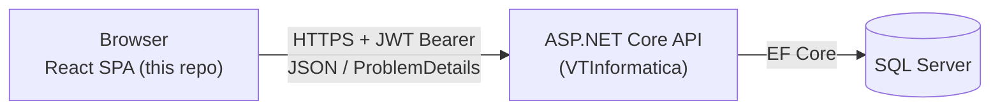

# VT Informatica – front end

[🇮🇹 Italiano](README.md) · 🇬🇧 English

Front end of an e-commerce site selling PC tech products: catalogue, search, cart, checkout, orders, reviews, account area and an `Admin` back office. It talks to the API in [VTInformatica](https://github.com/Anacronistico00/VTInformatica) (ASP.NET Core + SQL Server).

It started as a course final project (tag `v1-epicode`), then went through an audit and was realigned with the API contract (`v2-m4`). The [Before / after](#before--after) and [How I worked with AI](#how-i-worked-with-ai) sections tell the story.

## Stack

- React 19, Vite 6 (SWC plugin), JavaScript, React Router 7
- Redux Toolkit + Redux Persist (localStorage, 1 h expiry), React Bootstrap / Bootstrap 5, React Toastify, Framer Motion
- Tests: Vitest + Testing Library + MSW (network simulated on the real API contract); E2E: Playwright
- CI: GitHub Actions (lint, test, build)

## Architecture



- `src/Components/`: pages and components (`Admin/`, `Auth/`, `Home/`, `NavBar/`, `Products/`). Routes live in `App.jsx`; admin routes go through `Auth/roleRoute.jsx`.
- `src/Redux/`: `Actions` (thunks), `Reducers`, `Store`. HTTP calls live **only** in the actions.
- `src/Utils/apiClient.js`: the single HTTP client (base URL from `VITE_API_URL`, `Authorization` header, 204, network errors, `ProblemDetails` → `ApiError { status, code, detail, errors }`). A 401 on a request carrying a token logs the user out.
- API errors are told apart by the `code` field, never by message text; user-facing messages live in one file.
- Identity comes from the token on the BE side (`/me` routes): the FE role check (`RoleRoute`) is UX only, security is in the API.
- Tests sit next to the file they verify (`*.test.js[x]`); setup, MSW server and test JWTs are in `src/test/`.

## Running locally

Prerequisites: Node 22 and the API running (see the [BE README](https://github.com/Anacronistico00/VTInformatica#readme): database, JWT key via User Secrets, first admin).

1. **Clone both repos** side by side:

   ```bash
   git clone https://github.com/Anacronistico00/vtinformatica_fe.git
   git clone https://github.com/Anacronistico00/VTInformatica.git
   ```

2. **Start the BE** (from the `VTInformatica` folder): database from `DatabaseScript.sql` + `dotnet ef database update`, key with `dotnet user-secrets set "Jwt:SecurityKey" "<at least 32 characters>" --project VTInformatica`, then:

   ```bash
   dotnet run --project VTInformatica --launch-profile https   # https://localhost:7286
   ```

3. **Configure the FE.** The API URL comes from `VITE_API_URL`; it is never in the code. `.env.local` is not committed (`.env.example` documents the variables):

   ```bash
   cd vtinformatica_fe
   npm ci
   cp .env.example .env.local   # VITE_API_URL=https://localhost:7286
   ```

4. **Start the FE:**

   ```bash
   npm run dev                  # http://localhost:5173
   ```

   `http://localhost:5173` is the origin the BE's CORS allows by default.

5. **First admin, via the DB.** Every registration creates a `Customer`; to get the back office, register the user from the FE and grant the role (the BE has no endpoint to create admins yet):

   ```sql
   INSERT INTO AspNetUserRoles (UserId, RoleId)
   SELECT u.Id, r.Id
   FROM AspNetUsers u, AspNetRoles r
   WHERE u.Email = 'your@email.com' AND r.Name = 'Admin';
   ```

   Then log in again: the role is in the token.

## Tests

```bash
npm test          # Vitest + Testing Library + MSW
npm run lint
npm run build
```

These are the same checks as CI (no backend and no secrets: the network is simulated with MSW). Every logic change has a test; for known bugs, a red test first, then the fix.

## E2E (Playwright)

Full flows in the browser against the **BE and a SQL Server DB** (login → cart → checkout → order, account, back office, reviews). Locally they use the local BE and DB; in CI they run in the `E2E` workflow on PRs to `develop` and `main` (see below).

```bash
npx playwright install chromium   # once
npm run e2e
```

The E2E FE port is **fixed: 5174**, with `--strictPort` (if it is taken the run fails instead of moving elsewhere); 5173 stays free for development. The BE must therefore allow that origin in CORS. If you let Playwright start the BE it does so itself; if the BE is already running (it is reused), **restart it with**:

```bash
Cors__AllowedOrigins__1=http://localhost:5174 dotnet run --project VTInformatica --launch-profile https
```

(PowerShell: `$env:Cors__AllowedOrigins__1='http://localhost:5174'` before `dotnet run`.) There is no need to touch the BE's `appsettings.json`. Without this origin the login in the E2E run fails with "Server non raggiungibile".

Variables (Windows authentication to SQL Server, no password in the repo):

| Variable           | Default                  | Use                                                          |
| ------------------ | ------------------------ | ------------------------------------------------------------ |
| `E2E_API_URL`      | `https://localhost:7286` | BE URL                                                       |
| `E2E_FE_PORT`      | `5174`                   | E2E FE port                                                  |
| `E2E_SQLCMD`       | `sqlcmd`                 | sqlcmd executable                                            |
| `E2E_SQL_SERVER`   | `(local)`                | Server (e.g. `np:\\.\pipe\MSSQL$SQLEXPRESS\sql\query`)       |
| `E2E_SQL_DATABASE` | `VTInformatica`          | Database                                                     |

From Git Bash the backslashes of the named pipe must be doubled and `MSYS_NO_PATHCONV=1` helps, e.g. `MSYS_NO_PATHCONV=1 E2E_SQL_SERVER='np:\\\\.\\pipe\\MSSQL$SQLEXPRESS\\sql\\query' npm run e2e`.

The tests create `e2e.*@example.test` users and `E2E …` products and delete them at the end of the run (only those, in one transaction). **Back up the DB before the first run.** Details in [`e2e/README.md`](e2e/README.md) (Italian).

### E2E in CI

The [`e2e.yml`](.github/workflows/e2e.yml) workflow runs on PRs to `develop` and `main`: an `mssql` 2022 service container, a checkout of the BE (`master` branch), `dotnet ef database update` with the real migrations, a check of the minimal data ([`e2e/ci/seed.sql`](e2e/ci/seed.sql): roles and the base catalogue come from the migrations' seed), the BE started with `Cors__AllowedOrigins__1=http://localhost:5174` and a JWT key generated at run time (never stored), then `npm run e2e` with SQL authentication (`E2E_SQL_USER`, `E2E_SQL_PASSWORD`). On failure, the Playwright report and traces are kept as a run artifact.

## Before / after

FE part, recomputed from the tags `v1-epicode` and `v2-m4` (clean worktree per tag: `npm ci`, `npm run lint`, `npm test`, `npm run build`, `npm audit`, `git diff --shortstat`).

| | `v1-epicode` | `v2-m4` |
|---|---:|---:|
| FE tests (Vitest) | 0 | **93** (+ 8 E2E flows) |
| Lint (`npm run lint`) | 5 problems (2 errors, 3 warnings) | **0** |
| `npm audit` | 16 (12 high, 2 moderate, 2 low) | **0** |
| Build warnings | 1 (chunk > 500 kB) | 1 (unchanged) |
| CI | none | lint + test + build |
| `.js/.jsx` files in `src/` | 52 | 86 |
| Diff vs `v1-epicode` | – | 87 files, +8418 −1505 |

The E2E tests only run locally. Audit items closed: `VITE_API_URL` instead of the hardcoded URL, a single `apiClient`, token in one place, 401 → logout, `/me` routes instead of the email in the URL, tests and CI, lint and `npm audit` at 0, back office with server-side pagination and `expectedQuantity` (details in [`docs/AUDIT-prima.md`](docs/AUDIT-prima.md), in Italian).

The full table, with the BE numbers per tag (`v1-epicode` → `v2-m4-be`), is in the [BE README](https://github.com/Anacronistico00/VTInformatica#readme).

## How I worked with AI

Short version for the FE. The full story (plan review with a second model, examples of corrections, migrations, autonomy with a deny list) is in the [BE README](https://github.com/Anacronistico00/VTInformatica#readme).

- **Initial audit as the source of truth** ([`docs/AUDIT-prima.md`](docs/AUDIT-prima.md)): the baseline is never rewritten, each slice appends a status section.
- **Slices M4a–M4g.** One task, one branch, small commits, PR into `develop` with green CI. The plan is in [`docs/PIANO-M4.md`](docs/PIANO-M4.md) (in Italian).
- **Test-first.** For every bug a red test first (`test: red - …`), then the minimal fix, e.g. `test(store): red - …` followed by `fix(store): …`.
- **Autonomy with a deny list** from M3c: limits in `.claude/settings.json` and rules in `CLAUDE.md` (no direct push or merge to `main` and `develop`).
- **E2E tests found the NavBar crash**, already noted in the initial audit and never reproduced by tests with a simulated network. Persistence dropped an expired slice (expired token, cart idle for over an hour) and redux-persist's `autoMergeLevel1` copied `undefined` over the initial state: `state.auth` and `state.cart` were `undefined` on startup. Fixed test-first.

## Known limits and next steps

From the audit ("out of scope" sections and future work):

- **SuperAdmin and email.** Admins are currently created by hand in the DB. Planned on the BE: a `SuperAdmin` role, admin creation with an email invitation, "forgot password". The FE has no admin-management page yet.
- **Email → id.** The FE already uses only the `/me` routes; the BE has removed the old `{email}` routes. Still to do: migrating the key from email to `UserId` in the BE's DB (cart and orders are still tied to the email).
- **httpOnly cookie.** The token sits in localStorage (via redux-persist): an XSS can read it. The fix is an httpOnly cookie + refresh token, which needs BE changes. A CSP must be set as an HTTP header at deploy time (roughly `default-src 'self'; script-src 'self'; style-src 'self' 'unsafe-inline'; img-src 'self' https: data:; connect-src 'self' <VITE_API_URL>`).
- **Seller in the back office.** The BE lets `Seller` manage products and categories; the FE back office is `Admin`-only.
- **Components still large.** `ProductInfo` (339 lines) has not been split.

## Contact

- 📧 viktoryturiaci2323@gmail.com
- 💼 [Vittorio Turiaci](https://www.linkedin.com/in/vittorio-turiaci-2646a9333/)
