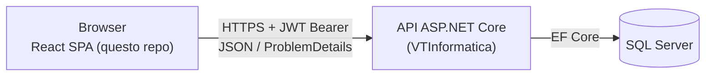

# VT Informatica – front end

🇮🇹 Italiano · [🇬🇧 English](README.en.md)

Front end di un e-commerce di prodotti tech per PC: catalogo, ricerca, carrello, checkout, ordini, recensioni, area account e backoffice per `Admin`. Parla con l'API in [VTInformatica](https://github.com/Anacronistico00/VTInformatica) (ASP.NET Core + SQL Server).

Nato come progetto di fine corso (tag `v1-epicode`), è stato poi sottoposto a un audit e riallineato al contratto dell'API (`v2-m4`). Le sezioni [Prima / dopo](#prima--dopo) e [Come ho lavorato con l'AI](#come-ho-lavorato-con-lai) raccontano come.

## Stack

- React 19, Vite 6 (plugin SWC), JavaScript, React Router 7
- Redux Toolkit + Redux Persist (localStorage, scadenza 1 h), React Bootstrap / Bootstrap 5, React Toastify, Framer Motion
- Test: Vitest + Testing Library + MSW (rete simulata sul contratto reale dell'API); E2E: Playwright
- CI: GitHub Actions (lint, test, build)

## Architettura



- `src/Components/`: pagine e componenti (`Admin/`, `Auth/`, `Home/`, `NavBar/`, `Products/`). Le rotte stanno in `App.jsx`; quelle admin passano da `Auth/roleRoute.jsx`.
- `src/Redux/`: `Actions` (thunk), `Reducers`, `Store`. Le chiamate HTTP stanno **solo** nelle actions.
- `src/Utils/apiClient.js`: unico client HTTP (base URL da `VITE_API_URL`, header `Authorization`, 204, errori di rete, `ProblemDetails` → `ApiError { status, code, detail, errors }`). 401 su una richiesta con token → logout.
- Gli errori dell'API si distinguono dal campo `code`, mai dal testo; i messaggi per l'utente stanno in un solo file.
- L'identità viene dal token lato BE (route `/me`): il controllo di ruolo nel FE (`RoleRoute`) è solo UX, la sicurezza è nell'API.
- I test stanno accanto al file che verificano (`*.test.js[x]`); setup, server MSW e JWT di test in `src/test/`.

## Avvio in locale

Prerequisiti: Node 22, e l'API in esecuzione (vedi [README del BE](https://github.com/Anacronistico00/VTInformatica#readme): database, chiave JWT con User Secrets, primo admin).

1. **Clona i due repo** uno accanto all'altro:

   ```bash
   git clone https://github.com/Anacronistico00/vtinformatica_fe.git
   git clone https://github.com/Anacronistico00/VTInformatica.git
   ```

2. **Avvia il BE** (dalla cartella `VTInformatica`): database da `DatabaseScript.sql` + `dotnet ef database update`, chiave con `dotnet user-secrets set "Jwt:SecurityKey" "<almeno 32 caratteri>" --project VTInformatica`, poi:

   ```bash
   dotnet run --project VTInformatica --launch-profile https   # https://localhost:7286
   ```

3. **Configura il FE.** L'URL dell'API viene da `VITE_API_URL`; non è mai nel codice. Il file `.env.local` non si committa (`.env.example` documenta le variabili):

   ```bash
   cd vtinformatica_fe
   npm ci
   cp .env.example .env.local   # VITE_API_URL=https://localhost:7286
   ```

4. **Avvia il FE:**

   ```bash
   npm run dev                  # http://localhost:5173
   ```

   `http://localhost:5173` è l'origine ammessa dal CORS del BE di default.

5. **Primo admin, via DB.** Ogni registrazione crea un `Customer`; per avere il backoffice registra l'utente dal FE e assegnagli il ruolo (il BE non ha ancora un endpoint per creare admin):

   ```sql
   INSERT INTO AspNetUserRoles (UserId, RoleId)
   SELECT u.Id, r.Id
   FROM AspNetUsers u, AspNetRoles r
   WHERE u.Email = 'tua@email.it' AND r.Name = 'Admin';
   ```

   Poi rifai il login: il ruolo sta nel token.

## Test

```bash
npm test          # Vitest + Testing Library + MSW
npm run lint
npm run build
```

Sono gli stessi controlli della CI (nessun backend né segreto: la rete è simulata con MSW). Ogni cambio di logica ha un test; per i bug noti prima un test rosso, poi il fix.

## E2E (Playwright)

Flussi completi nel browser contro il **BE e il DB SQL Server locali** (login → carrello → checkout → ordine, account, backoffice, recensioni). Non girano in CI.

```bash
npx playwright install chromium   # una volta
npm run e2e
```

La porta del FE degli E2E è **fissa: 5174**, con `--strictPort` (se è occupata il test fallisce invece di spostarsi); la 5173 resta libera per lo sviluppo. Per questo il BE deve ammettere quell'origine nel CORS. Se lo lasci avviare a Playwright lo fa da solo; se è già acceso (viene riusato) **riavvialo con**:

```bash
Cors__AllowedOrigins__1=http://localhost:5174 dotnet run --project VTInformatica --launch-profile https
```

(PowerShell: `$env:Cors__AllowedOrigins__1='http://localhost:5174'` prima di `dotnet run`.) Non serve toccare `appsettings.json` del BE. Senza questa origine il login negli E2E fallisce con "Server non raggiungibile".

Variabili (autenticazione Windows a SQL Server, nessuna password nel repo):

| Variabile          | Default                  | Uso                                                          |
| ------------------ | ------------------------ | ------------------------------------------------------------ |
| `E2E_API_URL`      | `https://localhost:7286` | URL del BE                                                   |
| `E2E_FE_PORT`      | `5174`                   | Porta del FE degli E2E                                       |
| `E2E_SQLCMD`       | `sqlcmd`                 | Eseguibile sqlcmd                                            |
| `E2E_SQL_SERVER`   | `(local)`                | Server (es. `np:\\.\pipe\MSSQL$SQLEXPRESS\sql\query`)        |
| `E2E_SQL_DATABASE` | `VTInformatica`          | Database                                                     |

Da Git Bash i backslash della named pipe vanno raddoppiati e conviene `MSYS_NO_PATHCONV=1`, ad esempio `MSYS_NO_PATHCONV=1 E2E_SQL_SERVER='np:\\\\.\\pipe\\MSSQL$SQLEXPRESS\\sql\\query' npm run e2e`.

Gli E2E creano utenti `e2e.*@example.test` e prodotti `E2E …` e li cancellano a fine run (solo quelli, in una transazione). **Fai un backup del DB prima della prima esecuzione.** Dettagli in [`e2e/README.md`](e2e/README.md).

## Prima / dopo

Parte FE, ricalcolata dai tag `v1-epicode` e `v2-m4` (worktree pulito per tag: `npm ci`, `npm run lint`, `npm test`, `npm run build`, `npm audit`, `git diff --shortstat`).

| | `v1-epicode` | `v2-m4` |
|---|---:|---:|
| Test FE (Vitest) | 0 | **93** (+ 8 flussi E2E) |
| Lint (`npm run lint`) | 5 problemi (2 errori, 3 avvisi) | **0** |
| `npm audit` | 16 (12 high, 2 moderate, 2 low) | **0** |
| Avvisi build | 1 (chunk > 500 kB) | 1 (invariato) |
| CI | nessuna | lint + test + build |
| File `.js/.jsx` in `src/` | 52 | 86 |
| Diff vs `v1-epicode` | – | 87 file, +8418 −1505 |

Gli E2E girano solo in locale. Voci dell'audit chiuse: `VITE_API_URL` al posto dell'URL hardcoded, `apiClient` unico, token in un solo posto, 401 → logout, route `/me` al posto dell'email nell'URL, test e CI, lint e `npm audit` a 0, backoffice con paginazione dal server e `expectedQuantity` (dettaglio in [`docs/AUDIT-prima.md`](docs/AUDIT-prima.md)).

La tabella completa, con i numeri del BE per tag (`v1-epicode` → `v2-m4-be`), è nel [README del BE](https://github.com/Anacronistico00/VTInformatica#prima--dopo).

## Come ho lavorato con l'AI

Versione breve per il FE. La storia completa (revisione dei piani con un secondo modello, esempi di correzioni, migration, autonomia con deny list) è nel [README del BE](https://github.com/Anacronistico00/VTInformatica#come-ho-lavorato-con-lai).

- **Audit iniziale come fonte di verità** ([`docs/AUDIT-prima.md`](docs/AUDIT-prima.md)): la baseline non si riscrive, ogni fetta aggiunge una sezione di stato.
- **Fette M4a–M4g.** Un task, un branch, commit piccoli, PR verso `develop` a CI verde. Il piano è in [`docs/PIANO-M4.md`](docs/PIANO-M4.md).
- **Test-first.** Per ogni bug prima un test rosso (`test: red - …`), poi il fix minimo, ad esempio `test(store): red - …` seguito da `fix(store): …`.
- **Autonomia con deny list** dalla M3c: limiti in `.claude/settings.json` e regole in `CLAUDE.md` (niente push o merge diretti su `main` e `develop`).
- **Gli E2E hanno trovato il crash della NavBar**, già annotato nell'audit iniziale e mai riprodotto dai test con rete simulata. La persistenza scartava uno slice scaduto (token scaduto, carrello inattivo da oltre un'ora) e `autoMergeLevel1` di redux-persist copiava `undefined` sullo stato iniziale: `state.auth` e `state.cart` erano `undefined` all'avvio. Corretto test-first.

## Limiti noti e prossimi passi

Dall'audit (sezioni "fuori scope" e lavoro futuro):

- **Test su SQL Server reale in CI.** Gli E2E e la corsa reale sullo stock girano solo in locale: servono SQL Server nel runner (container `mssql` in GitHub Actions) o Testcontainers, come previsto per il BE.
- **SuperAdmin ed email.** Oggi gli admin si creano a mano via DB. Previsto lato BE: ruolo `SuperAdmin`, creazione admin con invito via email, "password dimenticata". Il FE non ha ancora una pagina di gestione admin.
- **Email → id.** Il FE usa già solo le route `/me`; nel BE restano le vecchie route con `{email}` come `[Obsolete]`, da rimuovere.
- **Cookie httpOnly.** Il token sta in localStorage (via redux-persist): un XSS può leggerlo. La soluzione è cookie httpOnly + refresh token, che richiede modifiche al BE. Al deploy va impostata una CSP come header HTTP (indicativamente `default-src 'self'; script-src 'self'; style-src 'self' 'unsafe-inline'; img-src 'self' https: data:; connect-src 'self' <VITE_API_URL>`).
- **Seller nel backoffice.** Il BE consente a `Seller` prodotti e categorie; il backoffice del FE è solo per `Admin`.
- **Componenti ancora grandi.** `ProductInfo` (339 righe) non è stato spezzato.

## Contatti

- 📧 viktoryturiaci2323@gmail.com
- 💼 [Vittorio Turiaci](https://www.linkedin.com/in/vittorio-turiaci-2646a9333/)
